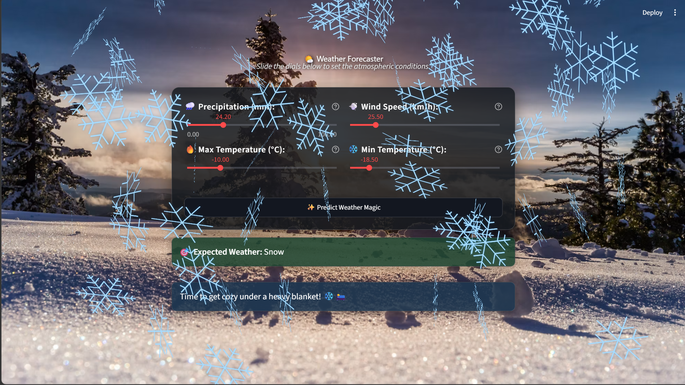

# 🌤️ Weather Predictor

Welcome to the ** Weather Predictor**! 

Have you ever looked at the temperature and wind speed and wondered, *"Is it a 'read-a-book-by-the-window' kind of day, or a 'grab-sunglasses-and-go' kind of day?"* I built this interactive web app to take the guesswork out of the forecast. Powered by a Machine Learning model, this app takes a few basic atmospheric details and predicts the exact weather vibe you can expect!

---

## 📸 A Peek at the Magic


*The app reacts to the forecast with fun animations and cozy suggestions.*

---

## ✨ Why It's Cool (Features)
I wanted this to feel more like a cozy dashboard than a boring calculator. Here is what makes it special:
* **Sleek "Dark Glass" UI:** A beautiful, translucent glassmorphism design that makes the text pop against a gorgeous sunset background.
* **Tactile Sliders:** No more typing numbers! Just drag the sliders to adjust precipitation, wind, and temperatures.
* **A Brain Behind the Beauty:** Uses a custom pre-trained Python Machine Learning model (`wp.pkl`) to calculate the outcome.
* **Dynamic Reactions:** If it predicts snow, your screen will actually snow! ❄️ If it's sunny, expect some celebratory balloons. 🎈

## 🛠️ What I Used to Build It
* **Language:** Python 🐍
* **Frontend/UI:** Streamlit (with custom CSS for that glass look!)
* **Machine Learning:** Scikit-Learn (for training the predictive model)

## 🚀 Want to run it on your own machine? 
It's super easy! Just follow these steps:

1. **Clone this repository** to your computer:
   ```bash
   git clone https://github.com/riteshh-01/Weather_Prediction_Model.git
   ```
2. **Open the folder** in your terminal:
   ```bash
   cd Weather_Prediction_Model
   ```
3. **Install the required libraries** (so the app has everything it needs to run):
   ```bash
   pip install -r requirements.txt
   ```
4. **Start the magic!** Run the app with Streamlit:
   ```bash
   streamlit run main2.py
   ```
5. A new tab will automatically open in your web browser. Grab a coffee and enjoy! ☕

---
**Created with ❤️ by Ritesh Kumar Anand**